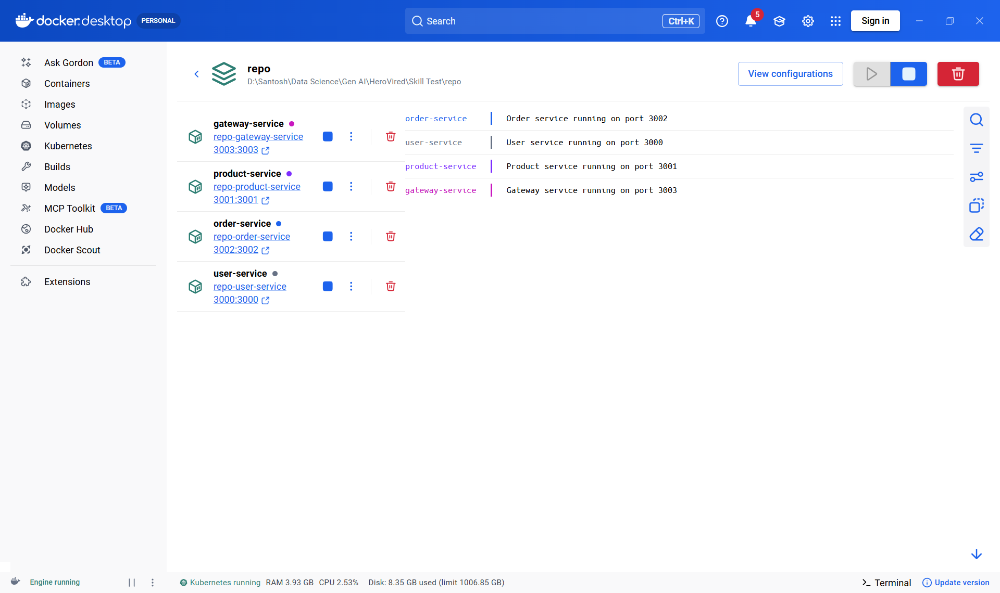
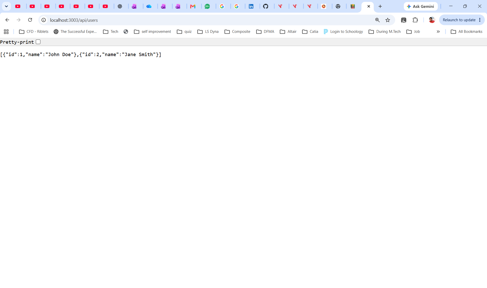

# Microservices Containerization – Skill Test 1: Cloud and Containers

This repo containerizes four Node.js (Express) microservices with Docker and runs them together with Docker Compose.

| Service         | Port | Endpoints                                        |
|-----------------|------|--------------------------------------------------|
| User Service    | 3000 | `GET /users`, `GET /health`                      |
| Product Service | 3001 | `GET /products`, `GET /health`                   |
| Order Service   | 3002 | `GET /orders`, `POST /orders`, `GET /health`     |
| Gateway Service | 3003 | `GET /api/users`, `GET /api/products`, `GET/POST /api/orders`, `GET /health` |

The gateway reaches the other services by their Compose service names (`http://user-service:3000`, and so on) over a shared bridge network named `microservices-net`.

## Project structure

```
.
├── docker-compose.yml
├── README.md
├── screenshots/                 # proof the services run in Docker
└── Microservices/
    ├── user-service/     (app.js, package.json, Dockerfile, .dockerignore)
    ├── product-service/  (app.js, package.json, Dockerfile, .dockerignore)
    ├── order-service/    (app.js, package.json, Dockerfile, .dockerignore)
    └── gateway-service/  (app.js, package.json, Dockerfile, .dockerignore)
```

## Dockerfiles

All four services use the same Dockerfile pattern:

- **Base image:** `node:20-alpine`, a small official Node.js LTS image.
- **Working directory:** `/usr/src/app`.
- **Dependencies:** copies `package*.json` first and runs `npm install --omit=dev`, so Docker caches the dependency layer.
- **Security:** runs as the non-root `node` user.
- **Port:** exposes the service's port (3000, 3001, 3002 or 3003).
- **Start command:** `CMD ["node", "app.js"]`.

## Docker Compose

`docker-compose.yml`:

- Defines all four services and builds each one from its own folder.
- Maps each container port to the same port on the host (`3000:3000` … `3003:3003`).
- Connects all services to the shared `microservices-net` bridge network.
- Adds a health check for every service that calls its `/health` endpoint.
- Starts the gateway only after user, product and order services are **healthy** (`depends_on` with `condition: service_healthy`).
- Sets `restart: unless-stopped`.

## Setup instructions

Prerequisites: Docker Desktop (or Docker Engine) with Docker Compose v2.

```bash
git clone https://github.com/31skpandit/Microservices-Task_HeroVired_Santoshkumar_Pandit.git
cd Microservices-Task_HeroVired_Santoshkumar_Pandit

docker compose up --build -d     # build images and start all services
docker compose ps                # all four should show "Up (healthy)"
```

Stop and clean up:

```bash
docker compose down              # stop and remove containers and the network
docker compose down --rmi local  # also remove the built images
```

## How to test each service

**Direct access to each service:**

```bash
curl http://localhost:3000/users      # [{"id":1,"name":"John Doe"},{"id":2,"name":"Jane Smith"}]
curl http://localhost:3001/products   # [{"id":1,"name":"Laptop","price":999},{"id":2,"name":"Phone","price":699}]
curl http://localhost:3002/orders     # [] (empty until an order is created)
```

**Health checks:**

```bash
curl http://localhost:3000/health
curl http://localhost:3001/health
curl http://localhost:3002/health
curl http://localhost:3003/health
```

**Through the gateway:**

```bash
curl http://localhost:3003/api/users
curl http://localhost:3003/api/products

# create an order, then list orders
curl -X POST http://localhost:3003/api/orders \
     -H "Content-Type: application/json" \
     -d '{"userId": 1, "productId": 2}'
curl http://localhost:3003/api/orders
```

On Windows PowerShell, use `curl.exe` instead of `curl`, or use `Invoke-RestMethod`:

```powershell
Invoke-RestMethod -Method Post -Uri http://localhost:3003/api/orders `
  -ContentType "application/json" -Body '{"userId":1,"productId":2}'
```

You can also open the `GET` URLs in a browser.

## Troubleshooting

| Problem | Fix |
|---------|-----|
| `failed to connect to the docker API` / `Cannot connect to the Docker daemon` | Start Docker Desktop and wait until it shows "Engine running". |
| `port is already allocated` | Another process is using 3000–3003. Find it with `netstat -ano \| findstr :3000` (Windows) or `lsof -i :3000` (Linux/macOS), stop it, or change the host port in `docker-compose.yml` (for example `"4000:3000"`). |
| Gateway returns `{"error":"Error fetching users"}` | A backend service is down or unhealthy. Check `docker compose ps` and `docker compose logs user-service`. |
| A container keeps restarting | Check its logs with `docker compose logs -f <service-name>`. |
| Code changes don't show up | Rebuild the images with `docker compose up --build -d`. |
| Start from a clean state | `docker compose down --rmi local -v`, then `docker compose up --build -d`. |

Note: the order service keeps orders in memory, so restarting it clears all orders.

## Screenshots

**All four containers running in Docker Desktop:**



**Gateway returning users at `http://localhost:3003/api/users`:**



The output from `docker compose ps` and from each endpoint is in [`screenshots/test-output.txt`](screenshots/test-output.txt).
